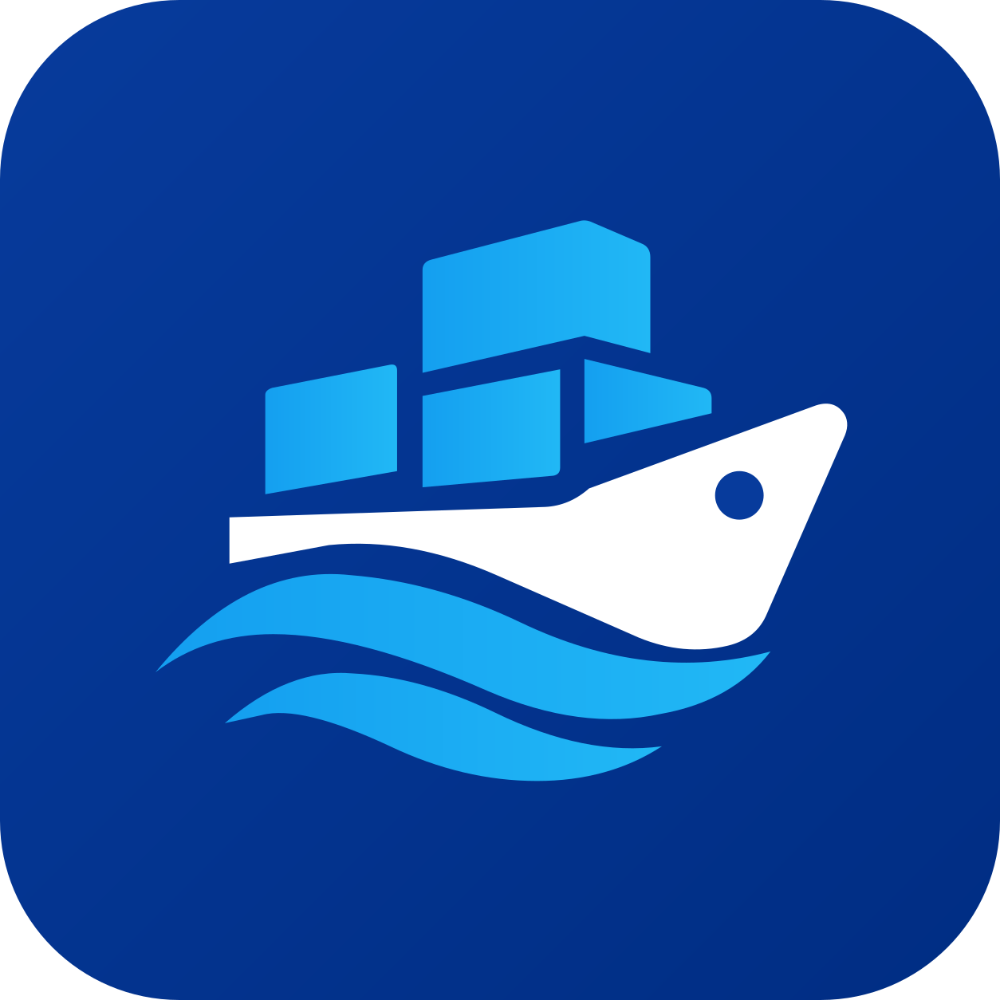

<div align="center">

<h1>FreeWilly</h1>
<p><strong>A free Docker Desktop alternative for Windows, under Apache-2.0: no headcount threshold, no revenue threshold, no licence to buy.</strong></p>
</div>

<div align="center">

**[Download `FreeWilly-Setup.exe`](https://github.com/alegauss/freewilly/releases/latest)** · per-user install, no admin prompt · no account, no telemetry

**[alegauss.github.io/freewilly](https://alegauss.github.io/freewilly/)**

</div>

Docker Desktop is free only below its own limits, and the reason to look for an alternative is
usually that your employer crossed one. FreeWilly installs and drives the Docker engine on Windows,
and the licence is [Apache-2.0](LICENSE), including the patent grant that makes a corporate legal
review straightforward.

- **A preflight, not a support case.** Before anything is installed, every check states a fact, a
  verdict and the one action that changes it.
- **An owned distribution.** The engine lives in a WSL2 distribution called `freewilly` that this
  tool created, so an `apt upgrade` or a `wsl --unregister` you ran for another reason cannot take
  it with it. Uninstalling is one command.
- **A tray icon and one window.** The icon carries the engine's state by shape, not only colour.
  The window lists containers (with *which kind of stopped*, ports as links, logs followed),
  images by size and volumes with what mounts them. Every heading sorts and every list filters.
- **Built for a coding agent too.** `freewilly read` answers what Docker cannot, such as what
  holds a port or why a container is not answering, in a few hundred tokens, and is safe to
  allow in one line because a read never mutates the engine.
- **No daemon of its own.** Quitting the tray leaves the engine exactly as it was.

## What it is not

These are binding, not aspirational. See the non-goals in [docs/ROADMAP.md](docs/ROADMAP.md):

- Feature parity with Docker Desktop
- A fork of the engine
- macOS and Linux
- Telemetry, accounts or a sign-in
- A resident background service
- A model, prompts or API keys
- A second Docker CLI

## Installing

Download [`FreeWilly-Setup.exe`](https://github.com/alegauss/freewilly/releases/latest) and run
it. It installs into `%LOCALAPPDATA%\FreeWilly` and **asks for no administrator prompt**, which is
what reaches a managed corporate laptop. The engine's WSL2 feature may still need elevation of its
own; the installer runs the preflight first and says so, rather than failing halfway through a
download.

Windows 10 2004 (build 19041) or later, 64-bit. Nothing else: the executable carries its own .NET
runtime. Then open the tray menu or the window and press **Start engine**. Nothing starts at logon
unless you ask, and `docker` resolves in terminals opened after the install.

Windows 11 puts a new tray icon in the overflow behind the chevron. Drag it onto the taskbar once
and Windows remembers; until then the state is in its tooltip.

Uninstalling removes what was installed and **asks about what was created**. The `freewilly`
distribution holds every image, container and volume you have, so it is never deleted without a
question, and an unattended uninstall keeps it.

The same executable is every verb:

```
FreeWilly.exe                 the tray icon and the window
FreeWilly.exe --tray          the tray icon alone, which is what "start with Windows" uses
FreeWilly.exe --preflight     what this machine can host; --json for a script
FreeWilly.exe --provision     download, verify and install the engine
FreeWilly.exe --run           start the engine and serve the pipe until Ctrl+C
FreeWilly.exe --help          every verb
```

A windowed program does not hold the prompt, so a typed verb prints *after* the prompt returns.
Redirecting (`FreeWilly.exe --preflight > report.txt`) avoids that, and is the form a script uses
anyway.

**If your shell is your own WSL2 distribution**, the Linux `docker` in it reaches nothing: the
daemon's socket lives in the distribution this tool owns, behind a Windows named pipe. Run the
Windows binary instead, `/mnt/c/Users/you/AppData/Local/FreeWilly/bin/docker.exe ps`, and keep in
mind that it reads every path as a Windows path, so `-v $(pwd):/data` mounts an empty directory.
`freewilly do compose up` respells bind sources for you. There is deliberately no
per-distribution integration: it would write into each distribution you tick and hand the Engine
API to all of them.

## With Claude Code

The installer leaves two files in `%LOCALAPPDATA%\FreeWilly\agent\` and copies neither anywhere,
because your agent configuration is yours. To use them, copy the skill where Claude Code looks for
one:

```
mkdir "%USERPROFILE%\.claude\skills\freewilly"
copy "%LOCALAPPDATA%\FreeWilly\agent\SKILL.md" "%USERPROFILE%\.claude\skills\freewilly\"
```

and add one line to the `allow` array in your `.claude/settings.json`:

```jsonc
"allow": ["Bash(freewilly read:*)"]
```

That grants every read and no write. `docker ps` and `docker rm -f -v` are the same string to an
allowlist, so a rule over `docker` either permits deleting a volume or stops to ask on every call.
`freewilly read` mutates nothing, and two guards in the build hold that: a read verb gets a handle
with no start, remove or prune on it, and a test requires every request a read makes to be a
`GET`.

Then ask Claude Code about the machine in plain words:

> Why isn't the shop api answering?

> Bring the stack up and wait until the database is ready.

> Clean up what you created for this repro.

### The verbs

```
freewilly read context       the whole machine in one budgeted payload
freewilly read doctor <name> why one container is not answering
freewilly read ps            every container, one line each; mutates nothing
freewilly read logs <name>   --since --level --dedup --budget --out --follow --until
freewilly read ports [port]  what holds a host port, which Docker cannot say
freewilly read verify <name> proof that it answers; --request --expect --wait
freewilly read changes       what moved; --since for a delta, --session for mine
freewilly do   engine start  brings the engine up
freewilly do   reclaim       remove exactly that, and nothing else
```

`read context` replaces a session's first five calls: **102 estimated tokens** for a five-service
stack, against 5718 for the three container-list reads a diagnosis makes today, and its first row
already says why the api is down:

```
engine  running  wsl:freewilly  api=v1.43  ctx=default(ok)
shop-api-1  exited 137  svc:shop/api  8080->8080/tcp  OOM  ×3  limit=512M
shop-db-1  up 4m (healthy)  svc:shop/db  5432->5432/tcp
disk    images 14G (2G dangling)  volumes 2
cursor  c:231884
```

`port is already allocated` is the refusal an agent cannot act on, because no Docker command knows
what holds the socket. A Windows process does:

```
$ freewilly read ports 135
port 135 is already held on this machine
  heldBy    pid 2416  svchost.exe  (path not readable by this process)
  fix       Stop process 2416 (svchost.exe), or publish a different host port.
```

The rest work the same way:

- **`read doctor`** joins what five commands used to leave to the caller and returns conclusions
  (killed for exceeding 512M, port published and nothing listening, a mount source missing), each
  with the action that fixes it.
- **`read verify`** connects to the published port from Windows, because *running* and
  *answering* are different facts. `--expect 404` proves a removed page is gone, and
  `--wait --timeout 30s` is the readiness check, so no sleep loop is needed.
- **`read logs`** is bounded by default and deduplicated (a container that restarted eight times
  went from 634 estimated tokens to 95), truncates with a cursor and never silently, and
  `--out <path>` writes a large log to a file you can grep. `--follow --until "<line>"` returns
  the moment that line arrives, and follows a compose service across a recreate.
- **`read changes --since <cursor>`** tells the next session what moved, collapsed per object,
  instead of re-reading the machine. A cursor older than the daemon's 256 events is refused, never
  answered with a silent partial.

Everything created through `do` is stamped with a session, so the cleanup is scoped to what this
piece of work made, never a machine-wide `prune`:

```
$ freewilly do reclaim --session repro-17
session  repro-17
would remove  2 container(s)
  container shop-api-1              exited  shop/api:latest
  container shop-db-1               running  postgres:16-alpine
KEEPING  1 volume(s)  a container comes back from its image; a volume comes back from nothing
  volume    shop-data               not mounted
  --volumes takes them too, and changes the token below.
confirm  freewilly do reclaim --session repro-17 --confirm k:6e80b8
```

The token is computed over that list, so a container that arrived between the two calls makes the
confirm refuse. The session is `DOCKERDESK_SESSION`; unset, it is derived from the working
directory and says so, as `dir:f00bf3`.

To start each session knowing the machine, `freewilly read context --as brief --out
.freewilly/brief.md` writes a brief from the live machine, with no timestamp, so an unchanged
machine produces no diff. Every response shape has a ceiling in
[`agent-budget.json`](agent-budget.json) that a test holds, and the design is in
[docs/specs/DD23-agent-first-freewilly.md](docs/specs/DD23-agent-first-freewilly.md).

## Licence and attribution

FreeWilly is [Apache-2.0](LICENSE). Copyright FreeWilly contributors.

The engine it installs is upstream software under its own terms, and those files are not
redistributed here. They are downloaded from their official locations at install time, against the
versions and digests this build pins. [NOTICE](NOTICE) lists every one of them, its licence and
where it came from; the window's **About** says the same thing where the choice is actually made.

## Building

```
dotnet build
dotnet test
build\build.cmd              one self-contained FreeWilly.exe
build\build-installer.cmd    that, wrapped in dist\FreeWilly-Setup.exe
```

Requires the .NET 10 SDK and Windows; the installer also needs [Inno Setup
6](https://jrsoftware.org/isdl.php), found machine-wide, per-user or on the PATH. The version is
stated once, in [Directory.Build.props](Directory.Build.props), and the installer reads it back off
the built `.exe`. The mark and the app icon are committed: `build\trace-logo.mjs` traces
[`build/logo-source.png`](build/logo-source.png) into `site/public/logo.svg` and the tray-sized
`build/icon.svg`, and `build\icon.mjs` rasterises those two into the `.ico`.

`FreeWilly.exe --capture-window <png> [page] --fixture` renders the window off-screen from a known
sample machine, every name starting with `sample-`, so a change to the window is reviewable as a
picture. The tray's menu is the one surface it cannot reach, and
[`tests/FreeWilly.Cases/TrayMenuPicture.cs`](tests/FreeWilly.Cases/TrayMenuPicture.cs), run by
`run-cases.cmd`, photographs it instead.

See [CONTRIBUTING.md](CONTRIBUTING.md) for how the roadmap, changelog and rationale under `docs/`
are written: they are governed by a tool, and a hand edit is refused.

## More tools by alegauss

For Claude Code:

- **[Claude Code Tray](https://alegauss.github.io/claude-tray/)**: your rate-limit usage as a Windows tray icon that turns red before you run out.
- **[roadkeep](https://alegauss.github.io/roadkeep/)**: keeps ROADMAP, CHANGELOG and IMPROVEMENTS to one format, as a CLI and a Claude Code plugin.
- **[commitclerk](https://alegauss.github.io/commitclerk/)**: Conventional Commits messages from your staged diff, in a single-file Python CLI.
- **[polyweave](https://alegauss.github.io/polyweave/)**: a Claude Code plugin that makes a game's 3D assets, sounds and names by declaring what each has to satisfy.

For Windows developers:

- **[winwright](https://alegauss.github.io/winwright/)**: drives a Windows desktop app from a test and reports what was actually observed.
- **[Quickshell](https://alegauss.github.io/quickshell/)**: an SSH client for Windows with sessions, keys, SFTP and tunnels, and without the rest of the suite.

All of them: [alegauss.github.io](https://alegauss.github.io/)
